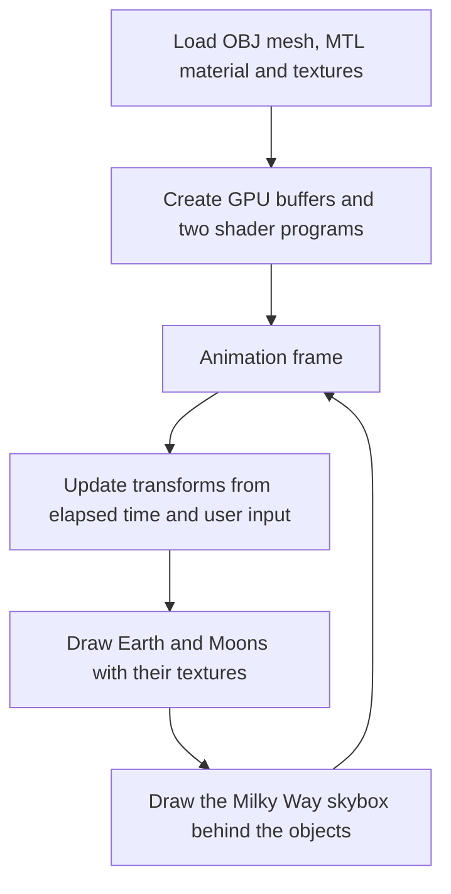

# Planetary

**An interactive Earth–Moon scene rendered in the browser with WebGL 2.**

Planetary is a Computer Graphics course project. It combines textured 3D geometry, custom GLSL shaders, lighting and an interactive camera to display a rotating Earth surrounded by one or more Moons, against a Milky Way skybox.

The application is written in JavaScript and uses WebGL directly, with helper libraries for matrices, mesh loading, WebGL setup and the control panel. All libraries and scene assets are included in the repository.

## What you can do

- Watch the Earth rotate continuously around its vertical axis.
- Move the Moons around the Earth using the mouse, keyboard or a touchscreen.
- Display **1 to 10 Moons**, evenly spaced around the Earth.
- Change the camera angle and field of view from the on-screen panel.

This is a graphics demonstration: sizes, distances and movements are chosen for the scene rather than astronomical accuracy. The Earth rotates automatically; the Moons move around it in response to user input.

## How it works

### Rendering loop



`requestAnimationFrame` schedules each frame. Depth testing resolves which surfaces are visible, and back-face culling skips triangles facing away from the camera. The renderer draws the central object and each Moon with their own world matrix, then switches to the skybox program.

### One mesh, different objects

The application loads the Moon's **OBJ** geometry and associated **MTL** material. It normalizes the mesh and prepares GPU buffers containing triangle positions, surface normals and texture coordinates.

The Earth and all the Moons reuse this same geometry. Their appearance comes from different textures and transformations: the central object uses the Earth texture, while the smaller surrounding objects use the Moon texture. Separate texture units let the renderer switch between them without rebuilding the geometry.

Each Moon is scaled to 40% of the central mesh's size and placed on a circle around it. Increasing the Moon count redistributes the objects evenly along that circle. The Earth's rotation follows elapsed time, while user input controls the angular offset of the Moons.

### Camera and lighting

Model, view and perspective projection matrices turn each object's local coordinates into positions on the canvas. The camera angle changes the view matrix, and the field-of-view slider changes the projection matrix.

The mesh vertex shader transforms vertices and passes normals, texture coordinates and the direction toward the viewer to the fragment shader. The fragment shader combines the sampled texture with ambient, directional diffuse and specular lighting, plus the material's emission term. These calculations give the objects their shading and highlights.

### Milky Way background

Six images form a **cubemap**, representing the surrounding Milky Way. The skybox has its own shader program and is rendered using a full-screen quad. Its shader uses the inverse view-direction/projection matrix to look up the appropriate direction in the cubemap.

Removing camera translation from the skybox's view matrix makes the background behave like a distant environment. Drawing it after the objects with the appropriate depth comparison keeps it behind the Earth and Moons.


## Controls

The panel appears at the top of the canvas.

| Input or control | Range | Effect |
| --- | --- | --- |
| Mouse | Click and drag horizontally on the canvas | Move the Moons around the Earth. |
| Touch | Drag horizontally on the canvas | Move the Moons around the Earth. |
| Keyboard | Left / right arrow keys | Move the Moons around the Earth in opposite directions. |
| **Field of View** | 30°–120° | Change the perspective projection: smaller values give a closer-looking view; larger values show more of the scene. |
| **Camera Angle** | 0°–360° | Move the camera around the scene's Y axis. |
| **Moon number** | 1–10 | Change how many Moons are drawn around the Earth. |
| **Show Face** | On / off | Switch the central object's texture between the author's photograph and the Earth. |

The horizontal drag and arrow controls change the Moons' positions around the Y axis. Use **Camera Angle** to change the viewpoint.


## Project structure

| Path | Purpose |
| --- | --- |
| [`index.html`](index.html) | Canvas, mesh and skybox shader sources, and script imports. |
| [`main.js`](main.js) | WebGL setup, camera, control panel, input handling and rendering loop. |
| [`utils.js`](utils.js) | Mesh/material loading, texture setup and geometry helpers. |
| [`styles.css`](styles.css) | Full-window canvas and control panel positioning. |
| [`libs/`](libs/) | Bundled helper libraries: `m4` for matrices, `glm_utils` and `mesh_utils` for mesh handling, `webgl-utils` for WebGL setup, jQuery for file requests, and dat.GUI for controls. |
| [`resources/models/moon/`](resources/models/moon/) | Moon mesh, material and associated textures. |
| [`resources/textures/`](resources/textures/) | Earth texture and the author's photograph. |
| [`resources/skybox/`](resources/skybox/) | Six cubemap images for the Milky Way background. |
| [`resources/icons/`](resources/icons/) | Application icons. |

The application code brings together asset loading, shader rendering, scene transformations and interaction. The bundled libraries supply the supporting utilities used by that code.

## Run locally

You need **Python 3** and a browser with **WebGL 2** support enabled. There is no build step or package installation.

Clone the repository, enter its directory and start a static HTTP server:

```sh
git clone https://github.com/frazah/planetarium.git
cd planetarium
python3 -m http.server 8000
```

Open [http://localhost:8000](http://localhost:8000) in your browser. Stop the server with `Ctrl+C` when you are finished.

Serve the project over HTTP instead of opening `index.html` directly: the application loads the OBJ mesh and its MTL material file through AJAX, as well as loading texture images. Python only serves these files; the rendering runs entirely in the browser.

## Reference

- [WebGL2 Fundamentals](https://webgl2fundamentals.org/) — reference for the WebGL techniques and helper utilities used in the project.

